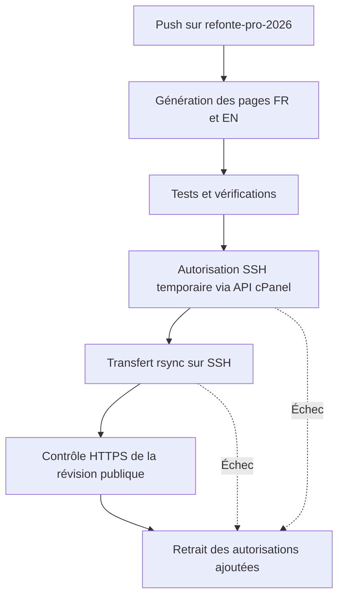

# François de Gennaro — réseaux et infrastructure

Portfolio bilingue d’un étudiant en informatique à Mons, certifié **Cisco CCST Networking**. Présentation des projets Java, SQL et infrastructure, avec un laboratoire IPv4 interactif.

[Voir le site](https://portfolio.jobandjudith.com/) · [English](README.en.md) · [CV français](https://portfolio.jobandjudith.com/assets/cv/CV_Francois_de_Gennaro_FR.pdf) · [CV anglais](https://portfolio.jobandjudith.com/assets/cv/CV_Francois_de_Gennaro_EN.pdf)

## À explorer

- Profil, compétences et projets avec leurs périmètres réels.
- Pages françaises et anglaises accessibles à des URL distinctes.
- Calculateur IPv4/CIDR de `/0` à `/32`, représentation binaire et défi réseau.
- Fiches des projets [Java](https://github.com/erebethos/le-dernier-des-palimpsestes) et [MariaDB](https://github.com/erebethos/palimpseste-bdd), avec liens vers leurs sources publiques.
- CV PDF téléchargeable dans la langue de la page et certification vérifiable sur Credly.

## Lancer localement

Prérequis : **Node.js 20 ou plus récent** pour générer et vérifier les pages ; **Python 3** pour le serveur local présenté ci-dessous. Aucune dépendance npm à installer.

```sh
git clone https://github.com/erebethos/vitrine-pro.git
cd vitrine-pro
git switch refonte-pro-2026
npm run build
npm test
npm run check
python3 -m http.server 8000 --directory dist
```

Ouvrir <http://localhost:8000/> ou <http://localhost:8000/en/>. Servir `dist/`, sans ouvrir les pages en `file://` : les modules JavaScript nécessitent HTTP.

## Architecture

Site statique en **HTML sémantique, CSS et JavaScript natifs**. Node.js sert au build, aux vérifications et au déploiement ; il n’est pas un serveur applicatif en production. Aucune base de données ni framework frontend.

| Chemin | Rôle |
|---|---|
| `dist/index.html` | Source française, lisible sans JavaScript |
| `dist/en/index.html` | Page anglaise générée |
| `dist/assets/content.mjs` | Traductions, fiches projets et URL des dépôts publics |
| `dist/assets/network.mjs` | Calcul IPv4 indépendant du DOM |
| `dist/assets/app.mjs` | Laboratoire, onglets et dialogues |
| `dist/assets/cv/` | CV français et anglais |
| `scripts/build-pages.mjs` | Génération EN et métadonnées selon l’origine |
| `tests/` | Tests du moteur IPv4 et garde-fous du déploiement |

Modifier la structure et les textes français dans `dist/index.html`, les traductions et messages dans `content.mjs`, puis régénérer. Ne pas modifier uniquement la page EN : elle serait écrasée au prochain build.

## Vérifications et choix techniques

Les **12 tests** couvrent les adresses invalides, limites arithmétiques, `/31`, `/32`, les invariants sur 2 145 échantillons déterministes, les défis et le périmètre du déploiement. `npm run check` contrôle les traductions, liens locaux, identifiants HTML, métadonnées, téléchargements PDF et liens vers les sources.

- Arithmétique non signée, sans opérateurs bit à bit signés JavaScript.
- `/31` traité comme une liaison point à point ; `/32` comme une adresse hôte unique.
- Calculs et défis exécutés dans le navigateur, sans envoyer les adresses saisies à un serveur.
- Liens de langue fonctionnels sans stockage local ; contenu principal accessible sans JavaScript.
- Onglets utilisables au clavier et dialogues natifs.
- Badge Cisco conservé sans modification et relié à [l’attestation nominative Credly](https://www.credly.com/badges/8d5ce9d3-778d-4cd7-ad94-d92cddac642f/public_url).

## Déploiement opérationnel



GitHub Actions publie sur **o2switch**, à l’adresse <https://portfolio.jobandjudith.com/>. La connexion vérifie la clé d’hôte SSH ; les secrets restent dans GitHub Actions. Les fichiers remplacés sont sauvegardés hors de la racine web ; ces sauvegardes différentielles ne constituent pas une copie intégrale du site.

Le build local utilise l’origine de validation définie dans `site.config.mjs`. Le workflow fournit `SITE_ORIGIN=https://portfolio.jobandjudith.com` pour les URL canoniques et `hreflang` publiques. Pour reproduire cette génération localement :

```sh
SITE_ORIGIN=https://portfolio.jobandjudith.com npm run build
SITE_ORIGIN=https://portfolio.jobandjudith.com npm run check
```

[Configuration du pipeline](docs/deploy-o2switch.md). `.openai/hosting.json` conserve l’identité de la version de validation Sites. La branche par défaut `refonte-pro-2026` contient le portfolio actuel ; `main` conserve le projet scolaire antérieur.

## Périmètre et suite

**Track, Flag & Execute est en conception** : la topologie d’accueil n’est pas une supervision réelle ni un moteur de simulation opérationnel. Java et SQL sont deux projets distincts ; les ressources Azure scolaires ne sont pas des services publics permanents. Une future application Python/SQL reste une piste, sans fonctionnalité annoncée comme livrée.

Auteur : **François de Gennaro**, Mons, Belgique. [LinkedIn](https://www.linkedin.com/in/françois-de-gennaro-it/) · [GitHub](https://github.com/erebethos).
